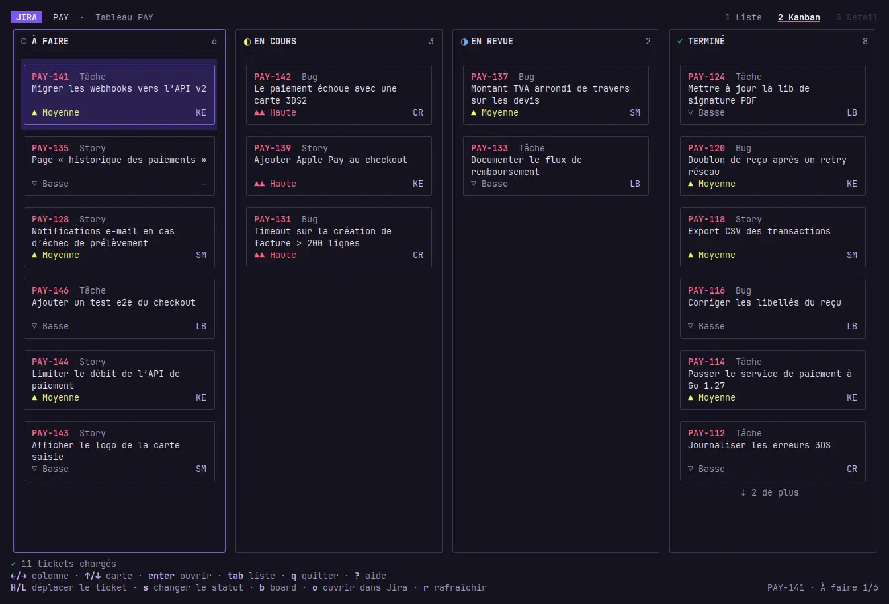

# jira-tui

[](https://github.com/boutdecode/jira-tui/actions/workflows/ci.yml)

A TUI for Jira Cloud, built with [Charm](https://charm.land/) (Bubble Tea / Bubbles / Lip Gloss v2). Go 1.27+.



## Install

    curl -fsSL https://raw.githubusercontent.com/boutdecode/jira-tui/main/install.sh | bash

The script downloads the binary for your system (Linux or macOS, amd64 or arm64) from the
[GitHub releases](https://github.com/boutdecode/jira-tui/releases), checks its SHA-256 checksum and installs it in
`/usr/local/bin` (or `~/.local/bin` when that one is not writable). Options, as environment variables:

    curl -fsSL https://raw.githubusercontent.com/boutdecode/jira-tui/main/install.sh | JIRA_TUI_VERSION=v1.0.0 INSTALL_DIR=$HOME/bin bash

The script also adds jira-tui to the application menu, with its own icon: a launcher in
`~/.local/share/applications/jira-tui.desktop` on Linux (it opens a terminal running jira-tui), or
`~/Applications/jira-tui.app` on macOS (Launchpad / Spotlight, opens Terminal). Set `JIRA_TUI_NO_MENU=1` to skip it.

Check with `jira-tui --version`. To uninstall, delete the binary and the menu entry (and `~/.local/share/icons/hicolor/scalable/apps/jira-tui.svg` on Linux). To build from source instead: `make build` (Go 1.27+).

### Publishing a release

Push a tag: the `Release` GitHub Action runs the tests, builds the four archives with `make dist` and attaches them,
with `checksums.txt`, to a new GitHub release (which is what `install.sh` downloads).

    git tag v1.0.0 && git push origin v1.0.0

## Running

    make demo        # fake data, no network
    make run         # against your Jira instance
    ./jira-tui --transparent   # keep your terminal background (transparency, image…)

## Command-line usage

    jira-tui                              # ticket list
    jira-tui PAY-142                      # open the ticket detail directly
    jira-tui https://x.atlassian.net/browse/PAY-142   # same, with the URL
    jira-tui PAY-142 --output-json        # no UI: the ticket as JSON on standard output

The reference is a key (case-insensitive) or a Jira URL (`/browse/PAY-142`, `?selectedIssue=PAY-142`).
Options can be placed before or after the reference. `--output-json` requires a reference and is never
interactive (no setup form).

    jira-tui PAY-142 --output-json | jq -r .status.name

The JSON (indented, UTF-8) contains: `key`, `id`, `url`, `summary`, `description` (plain text), `type`,
`status` (`name`, `category`), `priority`, `assignee`, `reporter`, `labels`, `components`, `created`, `updated`,
`original_estimate_seconds`, `comments` (`author`, `created`, `visibility` = `client` / `internal` / `unknown`, `body`),
and, if Tempo is configured, `time_spent_seconds` and `worklogs` (`null` otherwise). A missing value is `null`.
If Tempo or the comments cannot be read, the ticket is still exported and
`worklogs_error` / `comments_error` explains why (a warning is also printed on stderr).

Exit codes: `0` ok · `1` error (network, authentication, config, ticket not found) · `2` usage
(invalid or missing reference, unknown option). Errors are written to stderr, never to stdout.

## Language

The interface (screens, shortcuts, messages, `--help`, demo data) is available in **French** and **English**.
The language follows the system locale: `LC_ALL`, then `LC_MESSAGES`, `LANGUAGE` and `LANG` (the first one that is
set and is not `C`/`POSIX` decides). A French locale (`fr_FR.UTF-8`, `fr_CA`…) gives French, anything else gives English.
To force a language whatever the locale, set `JIRA_TUI_LANG=fr` or `JIRA_TUI_LANG=en`:

    JIRA_TUI_LANG=en jira-tui

Inputs are understood in both languages (`hier` / `yesterday`, `1j` / `1d`). The JSON output of `--output-json`
and the config file keys are the same in both languages.

## Configuration

On first launch, with no environment variables and no config file, the app shows a form
(URL, email, token). The credentials are checked against Jira and then saved to
`~/.config/jira-tui/config.yaml` (mode `0600`). Outside an interactive terminal, it stops and lists the missing values.

Environment variables (higher priority) or `~/.config/jira-tui/config.yaml`:

    url: https://xxx.atlassian.net
    email: you@example.com
    token: <Atlassian API token>
    default_jql: assignee = currentUser() AND resolution = Unresolved ORDER BY updated DESC
    filters:
      - {name: My bugs, jql: "assignee = currentUser() AND type = Bug"}

Env: `JIRA_URL`, `JIRA_EMAIL`, `JIRA_TOKEN`. Token: https://id.atlassian.com/manage-profile/security/api-tokens

## Time tracking (Tempo)

If you use Tempo, the Detail screen shows the logged time ("Temps passé" section, total and estimate)
and `t` lets you add some.

1. Create a **Tempo** token (separate from the Atlassian token): Tempo → Settings → *API integration* → *New token*
   (permissions: view and manage worklogs).
2. Add it to the config (or `TEMPO_TOKEN`):

        tempo_token: <Tempo token>
        tempo_url: https://api.tempo.io/4   # optional (other region: api.eu.tempo.io/4…)
        hours_per_day: 8                    # optional, for "1d"

Without `tempo_token`, the app works as before. In the `t` dialog: **duration** (`1h30`, `45m`, `1.5h`, `2d`, `1d 2h`;
a bare number = minutes), **date** (empty = today, `hier`, `04/11`, `2026-11-04`) and an optional description.
Only adding is supported: to fix or delete a worklog, use Tempo.

## Client / internal comments (Jira Service Management)

`c` opens the "Nouveau commentaire" field, **visible to the customer by default**. `tab` switches between
`Client` (blue) and `Interne` (yellow, not visible to the customer); the label and the border color
always show the selected visibility. Each new comment starts again as `Client`.
Existing comments show `[client]` or `[interne]` (nothing if Jira does not say,
for example outside Service Management).

## Creating a ticket

`n` (from the list, the kanban or the detail) opens the creation form. `tab` / `shift+tab` move between the fields,
`ctrl+s` creates the ticket from anywhere, `esc` cancels (a started draft asks for a confirmation first).

- **Project**: `enter` opens a searchable list of the projects you can create issues in. The form starts on the
  project of the open ticket, otherwise the last one used, otherwise the one of the tickets on screen.
- **Type**: `←/→` cycles through the issue types Jira offers for that project. **Sub-tasks** are offered when the form
  is opened from a ticket's detail: the parent is that ticket.
- **Title** (required) and **Description** (Markdown, with the `@` people and `#` ticket pickers: the people are those
  who can be assigned in the project).
- **Priority** (`←/→`, the project's default when left empty), **Labels** and **Assignee** (`←/→`: *Automatic* = the
  project's default assignee, or *Me*). A field Jira does not put on the form of this project or type is not shown.
- After creation the new ticket opens in the detail view and the list is reloaded. If Jira refuses, the form stays open
  with everything you typed and Jira's message.
- **Required fields the app cannot fill** (custom fields, components…) are detected from Jira's create metadata
  *before* sending: the form says which ones and refuses to send. `ctrl+o` opens Jira's own create page instead.

## Editing a ticket

In the detail, `e` opens the edit menu: **title**, **description**, **priority**, **labels**, **assignee**,
**edit a comment** and **delete a comment**. Each entry opens its own small form (`enter` or `ctrl+s` saves,
`esc` cancels without touching Jira), then the ticket and the list are reloaded.

- **Priority**: the choices come from Jira for this ticket (they follow the project's scheme). An entry Jira does not
  allow to edit on this ticket is greyed out with the reason.
- **Labels**: separated by commas or spaces (a Jira label cannot contain a space).
- **Assignee**: type to search among the people who can be assigned to the ticket (the search waits for a short pause
  in the typing); the first entry, "Unassigned", removes the assignee. `a` / `u` still assign to you / unassign.
- **Comments**: only **your own** comments are offered. Editing keeps the customer / internal visibility; deleting asks
  for a confirmation first.
- **Markdown**: descriptions and comments are edited as Markdown, so formatting is kept: `# headings`, `**bold**`,
  `*italic*`, `~~strike~~`, `` `code` ``, `[links](url)`, `- bullet` and `1. numbered` lists (nested by indenting),
  ` ``` ` code blocks, `> quotes` and `---`. A line break is a line break; a blank line starts a new paragraph. A backslash
  makes a character literal (`\*`). New comments (`c`) use the same syntax.
- **Mentions and tickets**: in any text area (new comment, comment or description edit), typing `@` opens a **user
  picker** and typing `#` a **ticket picker**. Keep typing to filter (the search waits for a short pause), `↑/↓` to
  choose, `enter` or `tab` to insert, `esc` to close the list (a second `esc` leaves the editor). The text stays
  readable (`@Sofia M.`, `#PAY-142`) and becomes a real Jira **mention** (the person is notified) or a **smart link**
  to the ticket when saved. The picker only opens at the start of a line or after a space or punctuation, so
  `name@example.com`, `C#` and Markdown headings (`# Title`) are left alone. Users are the people who can see the
  ticket and, in a Jira Service Management project, its **customers** (marked "customer"; they are not Jira users,
  so they come from the service desk API); tickets are Jira's issue picker (recent ones when nothing is typed). A `@Name` typed by hand, without the
  picker, stays plain text. Other links are written `<https://…>`.
- **Nothing is ever lost**: before offering a description or a comment for editing, the app converts it to Markdown
  and back and checks that it gets exactly the same document. If it does not (images, tables, panels, colors,
  underline, status lozenges, emojis, two paragraphs in a list item…), editing is refused with "content not editable here" and
  you are sent to Jira (`o`). Empty paragraphs used only for spacing are dropped on save.

## Jira automations (manual rules)

`x` (from the list, the kanban or the detail) lists the automations with a **"Manual" trigger** that apply to the
selected ticket and lets you run them. A confirmation is always requested (a rule can modify the ticket
or write to the customer). Rules that ask for input ("Get input from users") show a form:
`TEXT` and `NUMBER` types are supported; a rule with another input type (user, list…) is flagged and
never run — use Jira for that one.

Jira answers "started", not "finished": the rule then runs on the Jira side, and the app reloads the ticket 3 s later.

Prerequisite: the Jira token must be a **classic** (unscoped) API token; the Automation API accepts no other.
If the automatic search does not work on your instance, the error message is displayed and you can
declare your rules by hand (the id is in the URL of the rule editor):

    cloud_id: 182b9218-…          # optional, detected automatically
    automations:                  # optional: always offered in addition to the search
      - {name: "Escalader au support", id: "0192f2c3-…"}

## Shortcuts

Three tabs, as in the mockup: `1 Liste`, `2 Kanban`, `3 Détail` (last opened ticket).

| View | Keys |
|---|---|
| Global | `1` `2` `3` / `tab` tabs · `n` new ticket · `s` change status · `o` open in Jira · `b` choose a board · `?` help · `q` quit |
| List | `↑/↓` · `enter` open · `/` filter (text, live; `esc` clears) · `m` assigned me/everyone · `O` open/all · `ctrl+j` JQL query · `f` config filters · `r` reload |
| Kanban | `←/→` column · `↑/↓` card · `enter` open · `H/L` move the ticket (transition) |
| Detail | `↑/↓` scroll · `c` comment (`tab` client/internal, `ctrl+s` sends, `esc` cancels) · `e` edit the ticket · `t` add time (Tempo) · `a` assign to me · `u` unassign · `esc` back |

The "assigned: me" / "status: open" chips build the JQL
(`assignee = currentUser() AND resolution = Unresolved`). A JQL typed with `ctrl+j`
(or a config filter) replaces them until the next `m` / `O`.

If Jira answers 429, the request is retried up to 3 times (`Retry-After` header, otherwise 1 s, 2 s, 4 s).
